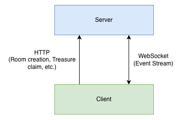
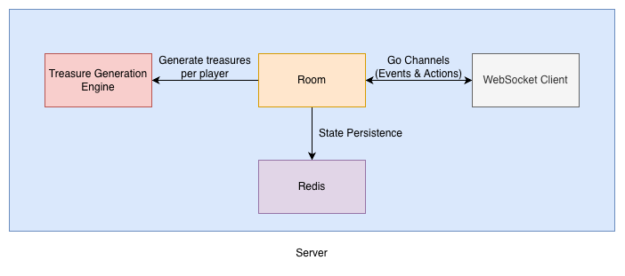

# Atlas Hunt

## Gameplay

This is a web-based multi-player game where players join a room to hunt treasures to collect points. After 3 rounds, the player with the highest score wins the game. Players can also donate treasures to other players.

## Architecture

The server is made in Go using the Gorilla websocket package, following an actor-based model where a single Goroutine handles all transactions of an ongoing game.

The following images illustrate the high-level and the real-time architectures of the project.

<br />

**High-Level Architecture:**

<p align="center">
  
</p>

<br />
<br />

**Real-time Architecture:**

<p align="center">
  
</p>

## WebSocket Events

All WebSocket message types are defined in [messages.go](./server/internal/wsmessages/messages.go), with direction annotated per event.

## Setup Instructions

### Prerequisites

- [Go](https://go.dev/dl/) (version from `server/go.mod`)
- [Node.js](https://nodejs.org/) and [pnpm](https://pnpm.io/installation)
- [Redis](https://redis.io/docs/latest/operate/oss_and_stack/install/install-redis/)
- `make`

### 1. Clone the repository

```bash
git clone https://github.com/aayush125/atlas-hunt.git
cd atlas-hunt
```

### 2. Configure environment variables

Both apps ship with example files. Copy them and fill in the values.

```bash
cp server/.envrc.example server/.envrc
cp web/.env.example web/.env
```

**Server** (`server/.envrc`)

| Variable          | Description                                                                             | Example                 |
| ----------------- | --------------------------------------------------------------------------------------- | ----------------------- |
| CC_REDIS_ADDR     | Redis host and port, as `address:port`                                                  | `localhost:6379`        |
| CC_REDIS_PASSWORD | Leave empty if your local Redis has none                                                |                         |
| CC_ENVIRONMENT    | One of `development`, `staging`, `production`                                           | `development`           |
| CC_PORT           | Port the server listens on                                                              | `4000`                  |
| CC_ORIGIN         | Origin allowed to open WebSocket connections. Must match where the web client is served | `http://localhost:5173` |

**Web** (`web/.env`)

| Variable          | Description         | Example                 |
| ----------------- | ------------------- | ----------------------- |
| PUBLIC_SERVER_URL | Base URL of the API | `http://localhost:4000` |
| PUBLIC_WS_BASE    | WebSocket endpoint  | `ws://localhost:4000`   |

### 3. Start Redis

```bash
redis-server
```

Check that it's running with `redis-cli ping` (it should reply `PONG`).

### 4. Start the server

```bash
cd server
make run/server
```

The server runs on the port set in your `.envrc`.

### 5. Start the web client

In a new terminal:

```bash
cd web
pnpm install
pnpm run dev
```

The client runs at <http://localhost:5173> by default.
